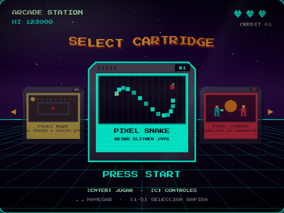
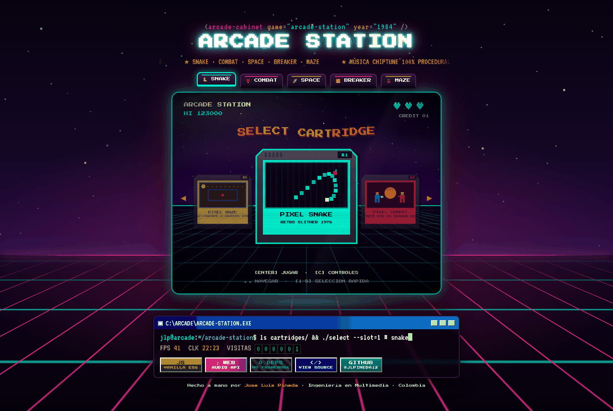
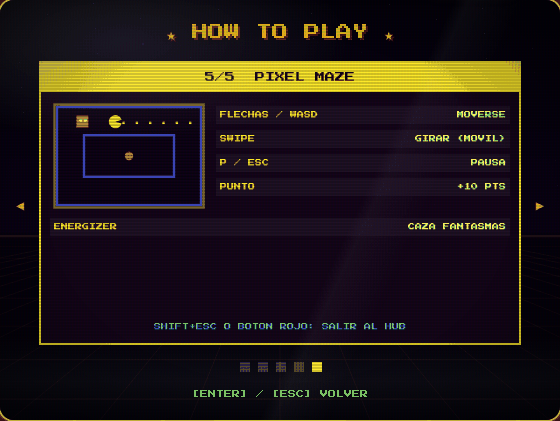
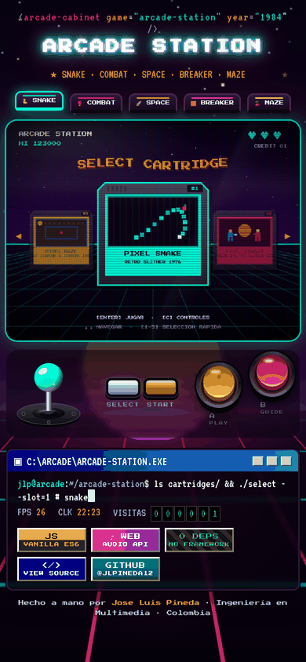
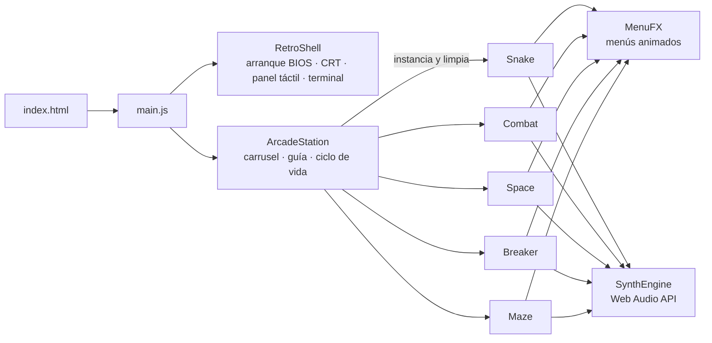

<div align="center">

<a href="https://jlpineda12.github.io/arcade-station/"></a>

# 🕹️ ARCADE STATION · 1984

**5 juegos retro en una sola pantalla CRT. Música chiptune generada en tiempo real. Cero dependencias.**

[](https://jlpineda12.github.io/arcade-station/)

[](https://github.com/Jlpineda12/arcade-station/actions/workflows/deploy.yml)


</div>

---

## 📺 Así se ve

<div align="center">

</div>

| Guía de controles por juego | En el celular |
| :---: | :---: |
|  |  |

**Lo que verás al entrar**

1. **Arranque tipo BIOS**: una terminal verde chequea CPU, GPU y audio y ejecuta `npm run arcade-station` (se salta con cualquier tecla).
2. **Encendido CRT**: la pantalla se enciende como un televisor de tubo; al cambiar de juego se apaga y vuelve a encender.
3. **Escenario synthwave**: sol con franjas, estrellas titilando y una cuadrícula de neón que avanza hacia ti.
4. **Selector de cartuchos**: cada juego es una ficha con **vista previa animada en vivo** de su jugabilidad.
5. **Barra de estado estilo 90s**: prompt de terminal que se escribe solo, FPS, reloj, contador de visitas y botones 88×31.

## 🎮 Los 5 juegos

| | Juego | Género | Jugar solo | Código |
| :-: | :--- | :--- | :---: | :---: |
| 🐍 | **Pixel Snake** | Serpiente clásica + chiptune procedural | [▶](https://jlpineda12.github.io/pixel-snake-arcade/) | [repo](https://github.com/Jlpineda12/pixel-snake-arcade) |
| 🥊 | **Pixel Combat** | Pelea 1v1 contra CPU con IA | [▶](https://jlpineda12.github.io/pixel-combat-arcade/) | [repo](https://github.com/Jlpineda12/pixel-combat-arcade) |
| 🚀 | **Pixel Space** | Invasores espaciales | [▶](https://jlpineda12.github.io/pixel-space-arcade/) | [repo](https://github.com/Jlpineda12/pixel-space-arcade) |
| 🧱 | **Pixel Breaker** | Rompe-ladrillos con power-ups | [▶](https://jlpineda12.github.io/pixel-breaker-arcade/) | [repo](https://github.com/Jlpineda12/pixel-breaker-arcade) |
| 🍒 | **Pixel Maze** | Laberinto con 4 fantasmas | [▶](https://jlpineda12.github.io/pixel-maze-arcade/) | [repo](https://github.com/Jlpineda12/pixel-maze-arcade) |

## 🕹️ Controles del hub

| Teclado | Panel táctil (móvil) | Acción |
| :--- | :--- | :--- |
| `←` `→` / `A` `D` | Joystick | Cambiar de cartucho |
| `1` – `5` | Fichas superiores | Elegir un juego directamente |
| `Enter` / `Space` | START · A | Insertar cartucho y jugar |
| `C` | SELECT · B | Guía de controles de cada juego |
| `Shift` + `Esc` | Botón rojo «SALIR» | Volver al hub desde cualquier juego |

Dentro de cada juego, el panel táctil cambia solo: en Combat A/B son **puño/patada**, en Space **disparo/bomba**, etc.

## 📊 Resultados

| Métrica | Resultado |
| :--- | :--- |
| Pruebas automatizadas | ✅ **24 / 24** en el hub + **213** en los 5 juegos (41 · 26 · 46 · 51 · 49) |
| CI/CD | Cada push a `main` corre las pruebas y, si pasan, despliega a GitHub Pages |
| Archivos de audio / imagen del juego | **0** — música, efectos y gráficos se generan con código |
| Dependencias de npm | **0** |
| Código | ≈ 12.000 líneas de JavaScript puro (ES modules) |
| Rendimiento | **60 FPS** en Canvas 2D |

## 🏛️ Arquitectura



```
arcade-station/
├── index.html                 # Marquesina, fichas de juegos, pantalla CRT, barra de estado
├── src/
│   ├── main.js                # Une hub + shell (títulos, botones táctiles, transiciones)
│   ├── hub/ArcadeStation.js   # Carrusel con vistas previas en vivo, guía y carga de juegos
│   ├── audio/                 # Música del lobby y efectos del hub
│   ├── shell/                 # Sistema visual compartido con los 5 repos de juegos
│   │   ├── RetroShell.js
│   │   └── shell.css
│   └── games/<juego>/
│       ├── game/              # Lógica + MenuFX.js (idéntico al repo individual)
│       └── audio/             # Síntesis propia de cada juego
├── test/qa-runner.js
├── docs/screenshots/
└── .github/workflows/deploy.yml
```

**¿Cómo conviven 5 juegos en un solo canvas?** Al insertar un cartucho, el hub intercepta los `addEventListener` que registra el juego y los guarda; al salir los elimina y detiene su música. Así cada juego se escribe como si fuera único, sin saber que vive dentro del hub.

## 🚀 Ejecutar en local

```bash
python3 -m http.server 8080
```

Abre `http://localhost:8080`. Pruebas:

```bash
npm test
```

## 👤 Autor

**Jose Luis Pineda Barrera** · [@Jlpineda12](https://github.com/Jlpineda12) · Ingeniería en Multimedia, Colombia 🇨🇴
